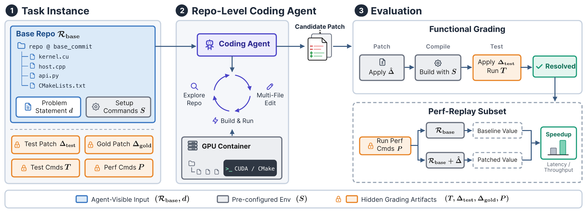

<div align="center">

**English** | [简体中文](README.zh-CN.md)

# SWE-GPU-Bench

### Can Language Models Solve Real-World GPU Software Engineering Tasks?

[](https://huggingface.co/datasets/Froze/SWE-GPU-Bench)
[](https://www.python.org/)
[](LICENSE)
[](https://github.com/chenfengshijie/SWE-GPU-Bench/actions/workflows/tests.yml)

[Overview](#-overview) • [Results](#-results) • [Installation](#-installation) • [Evaluation](#evaluation) • [Documentation](#-documentation)

</div>

---

## 👋 Overview

**SWE-GPU-Bench** is a benchmark for evaluating language models on real-world,
repository-level GPU software engineering. Given a **repository at its base
commit** and a **problem statement**, a model must generate a patch that fixes a
bug, implements a feature, or improves performance.

The benchmark spans **417 task records from 30 GPU repositories**, including
CUTLASS, CCCL, FlashInfer, Triton, and TensorFlow. Tasks require coordinated changes
across CUDA kernels, C++ host code, Python bindings, and build configurations.

<p align="center">
  
</p>

| Track | Tasks | Evaluation |
|---|---:|---|
| **General** | 378 | Patch application, compilation, and functional correctness |
| **Perf-Replay** | 39 | Functional correctness followed by runtime performance against the base commit |

The tracks cover **399 unique PRs**, with 18 PRs represented in both tracks.
These counts correspond to the paper's November 6, 2026 revision. The dataset is
actively maintained; pin its revision when reproducing results.

### Oracle and Agent settings

- **Oracle:** the model receives the base-version files touched by the gold patch
  and produces edits in one pass. Gold edits are hidden.
- **Agent:** a coding agent explores the repository, edits files, and uses build
  and execution feedback in a prepared GPU environment.

Candidate patches are graded in a fresh checkout with trusted tests. Gold
patches, test patches, and grading commands are withheld from the solver.
**Perf-Replay measures performance only after correctness passes.**

## 📊 Results

Selected **Test / resolution rates (%)** reported in the paper:

| Model | Oracle | Agent | Agent harness |
|---|---:|---:|---|
| **GPT-6-Astra** | **49.2** | **58.3** | Codex |
| GPT-6.1-Sol | 47.6 | 58.0 | Codex |
| GPT-5.6-Sol | 38.5 | 56.7 | Codex |
| DeepSeek-V4.1-Flash | 24.3 | 55.3 | OpenCode |
| DeepSeek-V4-Pro | 21.4 | 43.3 | OpenCode |

Results use a single pass@1 run per configuration. This table includes recent
models evaluated on the updated general set; earlier baselines have different
evaluation denominators. These are paper results, not measurements from a new
run of this release. Perf-Replay gains use small, model-specific passing sets
and should not be interpreted as a direct cross-model speedup ranking.

## 🚀 Installation

Use **Python 3.12+**, Git, and [uv](https://docs.astral.sh/uv/). GPU evaluation
requires Linux and a task-compatible CUDA environment; the paper uses NVIDIA
A100 and H100 GPUs. Match the image and GPU to the selected records.

```bash
git clone https://github.com/chenfengshijie/SWE-GPU-Bench.git
cd SWE-GPU-Bench
uv sync --frozen --extra test --python 3.12
uv run swe-gpu-bench --help
```

## 💽 Dataset

The dataset is available on [Hugging Face](https://huggingface.co/datasets/Froze/SWE-GPU-Bench).
With the `datasets` package installed, load either track:

```python
from datasets import load_dataset

# Pin revision="<dataset-commit>" for reproducible experiments.
general = load_dataset("Froze/SWE-GPU-Bench", "correctness", split="test")
perf_replay = load_dataset("Froze/SWE-GPU-Bench", "perf", split="test")
```

For the evaluation CLI, download `correctness.jsonl` and `perf.jsonl` from the
selected dataset revision. Each record includes the source repository, immutable
base commit, problem statement, setup/test commands, and reference/test patches;
Perf-Replay records additionally provide performance commands.

<a id="evaluation"></a>

## ⚙️ Evaluation

A **campaign** evaluates any combination of Oracle/Agent and General/Perf-Replay.
It freezes code, dataset records, model profiles, and scoring rules, and supports
local execution, Docker, or an external scheduler.

**1. Configure.** Copy the [campaign template](configs/evaluation/campaign.toml)
and [model profiles](configs/evaluation/profiles.toml) into the ignored `data/`
directory. Set dataset paths, output directory, model, backend, and GPU. Paths
are relative to the configuration file; see the [evaluation guide](docs/EVALUATION_CAMPAIGNS.md#install-and-configure).

**2. Prepare and run.** Use the environment variable named by your model profile:

```bash
export OPENAI_API_KEY=...  # your provider key; never commit it
git checkout master
git pull --ff-only origin master
uv run swe-gpu-bench evaluate campaign prepare --require-master --config data/my-campaign.toml

# Use the run directory printed by prepare.
uv run swe-gpu-bench evaluate campaign run --run <run-directory>
```

**3. Inspect or resume.**

```bash
uv run swe-gpu-bench evaluate campaign status --run <run-directory>
uv run swe-gpu-bench evaluate campaign resume --run <run-directory>
uv run swe-gpu-bench evaluate campaign summarize --run <run-directory>
```

> [!NOTE]
> `--require-master` checks that your clean checkout matches the live
> `origin/master` and records its commit and file hashes. Each prepared run keeps
> that frozen framework version when resumed. The framework commit is separate
> from each task's `base_commit`.

## 📚 Documentation

| Guide | Contents |
|---|---|
| [Evaluation](docs/EVALUATION_CAMPAIGNS.md) | Configuration, isolation, scoring, reports, and recovery |
| [Execution adapters](docs/EVALUATION_ADAPTERS.md) | Local, Docker, and external scheduler interfaces |
| [Dataset construction](docs/DATASET_CONSTRUCTION.md) | PR collection, filtering, command synthesis, fail-to-pass verification, and export |
| [Architecture](docs/ARCHITECTURE.md) | Package layout and CLI extensions |
| [Validation evidence](docs/EVALUATION_VALIDATION.md) | Earlier framework checks and H100 smoke outcomes, with their scope and limitations |

## 🛠️ Development

```bash
PYTEST_DISABLE_PLUGIN_AUTOLOAD=1 uv run pytest -q
uv build
```

Contributions to the framework, task reproducibility, and evaluation tooling are
welcome. Include a description of the change and relevant validation when opening
a pull request.

## 📄 License

Original framework code and original dataset contributions are covered by the
[MIT License](LICENSE), to the extent the contributors hold the relevant rights.
Upstream code, patches, and source text retain their original licenses and
notices. See [third-party licensing](THIRD_PARTY_NOTICES.md). The separately
hosted dataset's license metadata is managed in its own repository.
