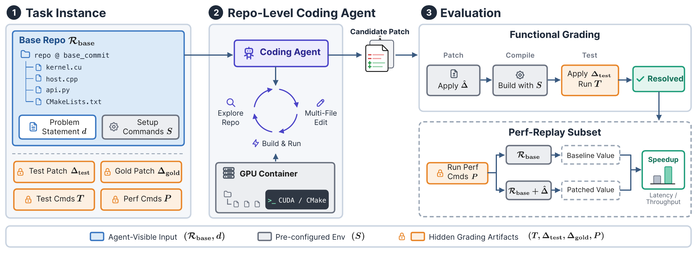

<div align="center">

[English](README.md) | **简体中文**

# SWE-GPU-Bench

### 语言模型能否解决真实世界的 GPU 软件工程任务？

[](https://huggingface.co/datasets/Froze/SWE-GPU-Bench)
[](https://www.python.org/)
[](LICENSE)
[](https://github.com/chenfengshijie/SWE-GPU-Bench/actions/workflows/tests.yml)

[概览](#overview) • [评估结果](#results) • [安装](#installation) • [运行评估](#evaluation) • [文档](#documentation)

</div>

---

<a id="overview"></a>

## 👋 概览

**SWE-GPU-Bench** 用于评估语言模型解决真实世界、仓库级 GPU 软件工程任务的能力。
给定处于 **base commit（基准提交）** 的代码仓库和一份**问题描述**，模型需要生成补丁，
完成缺陷修复、功能实现或性能优化。

基准包含来自 **30 个 GPU 代码仓库的 417 条任务记录**，涵盖 CUTLASS、CCCL、
FlashInfer、Triton 和 TensorFlow 等项目。任务要求模型协调修改 CUDA 内核、C++ 主机端代码、
Python 绑定和构建配置。

<p align="center">
  
</p>

| 评估轨道 | 任务数 | 评估内容 |
|---|---:|---|
| **General（通用任务）** | 378 | 补丁应用、编译和功能正确性 |
| **Perf-Replay（性能回放）** | 39 | 先验证功能正确性，再与基准提交比较运行性能 |

两条轨道覆盖 **399 个不同的 PR**，其中 18 个 PR 同时出现在两条轨道中。
上述统计对应论文 **2026 年 11 月 6 日修订版**。数据集持续维护，复现实验时请固定数据集版本。

### Oracle 与 Agent 两种设置

- **Oracle：** 模型接收参考补丁涉及的文件在基准提交中的内容，一次性生成修改；参考补丁的具体修改对模型隐藏。
- **Agent：** 编码智能体在预先准备好的 GPU 环境中探索仓库、编辑文件，并利用构建与执行反馈完成任务。

候选补丁在全新的仓库检出副本中通过可信测试进行评判。参考补丁、测试补丁和评分命令均不向求解模型开放。
**Perf-Replay 仅在正确性测试通过后测量性能。**

<a id="results"></a>

## 📊 评估结果

论文报告的部分 **Test / 任务解决率（%）** 如下：

| 模型 | Oracle | Agent | Agent 执行框架 |
|---|---:|---:|---|
| **GPT-6-Astra** | **49.2** | **58.3** | Codex |
| GPT-6.1-Sol | 47.6 | 58.0 | Codex |
| GPT-5.6-Sol | 38.5 | 56.7 | Codex |
| DeepSeek-V4.1-Flash | 24.3 | 55.3 | OpenCode |
| DeepSeek-V4-Pro | 21.4 | 43.3 | OpenCode |

每种配置只运行一次，以 pass@1 统计结果。表中列出在更新后的通用任务集上评估的近期模型；
较早基线使用的评估任务数量不同。这些数字来自论文，并非对本次发布版本重新运行所得的结果。
Perf-Replay 的性能收益基于各模型分别通过的少量任务，不应据此直接排列不同模型的加速效果。

<a id="installation"></a>

## 🚀 安装

请准备 **Python 3.12+**、Git 和 [uv](https://docs.astral.sh/uv/)。GPU 评估需要 Linux
及与任务兼容的 CUDA 环境；论文使用 NVIDIA A100 和 H100 GPU。请根据所选任务记录匹配镜像和 GPU。

```bash
git clone https://github.com/chenfengshijie/SWE-GPU-Bench.git
cd SWE-GPU-Bench
uv sync --frozen --extra test --python 3.12
uv run swe-gpu-bench --help
```

## 💽 数据集

数据集托管于 [Hugging Face](https://huggingface.co/datasets/Froze/SWE-GPU-Bench)。
安装 `datasets` 包后，可以分别加载两条轨道：

```python
from datasets import load_dataset

# 复现实验时，请设置 revision="<dataset-commit>" 以固定数据集版本。
general = load_dataset("Froze/SWE-GPU-Bench", "correctness", split="test")
perf_replay = load_dataset("Froze/SWE-GPU-Bench", "perf", split="test")
```

使用评估命令行工具时，请从选定的数据集版本下载 `correctness.jsonl` 和 `perf.jsonl`。
每条记录包含来源仓库、不可变的基准提交、问题描述、环境准备与测试命令，以及参考补丁和测试补丁；
Perf-Replay 记录还包含性能测试命令。

<a id="evaluation"></a>

## ⚙️ 运行评估

一个 **campaign（评估实验）** 可以运行 Oracle/Agent 与 General/Perf-Replay 的任意组合。
它会冻结代码、数据集记录、模型配置和评分规则，支持本地执行、Docker 或外部调度器。

**1. 配置实验。** 将 [campaign 模板](configs/evaluation/campaign.toml)
和[模型配置模板](configs/evaluation/profiles.toml)复制到 Git 忽略的 `data/` 目录中，
设置数据集路径、输出目录、模型、执行后端和 GPU。配置中的路径相对于配置文件所在目录解析；
详见[评估指南](docs/EVALUATION_CAMPAIGNS.md#install-and-configure)。

**2. 准备并运行。** 使用模型配置中指定的环境变量提供凭据：

```bash
export OPENAI_API_KEY=...  # 填入服务商密钥，切勿提交到仓库
git checkout master
git pull --ff-only origin master
uv run swe-gpu-bench evaluate campaign prepare --require-master --config data/my-campaign.toml

# 将 <run-directory> 替换为 prepare 输出的运行目录。
uv run swe-gpu-bench evaluate campaign run --run <run-directory>
```

**3. 查看状态或恢复运行。**

```bash
uv run swe-gpu-bench evaluate campaign status --run <run-directory>
uv run swe-gpu-bench evaluate campaign resume --run <run-directory>
uv run swe-gpu-bench evaluate campaign summarize --run <run-directory>
```

> [!NOTE]
> `--require-master` 会检查工作区是否干净、当前检出版本是否与实时查询的 `origin/master` 一致，
> 并记录提交号和文件哈希。准备好的实验在恢复时继续使用已冻结的框架版本。
> 框架提交与每条任务记录中的 `base_commit` 是两个独立的版本信息。

<a id="documentation"></a>

## 📚 文档

| 指南 | 内容 |
|---|---|
| [评估指南](docs/EVALUATION_CAMPAIGNS.md) | 配置、隔离、评分、报告与恢复 |
| [执行适配器](docs/EVALUATION_ADAPTERS.md) | 本地、Docker 和外部调度器接口 |
| [数据集构建](docs/DATASET_CONSTRUCTION.md) | PR 收集与过滤、命令合成、失败到通过的验证及数据导出 |
| [架构说明](docs/ARCHITECTURE.md) | 包结构与命令行扩展 |
| [验证记录](docs/EVALUATION_VALIDATION.md) | 历史框架检查与 H100 冒烟结果，以及适用范围和限制 |

## 🛠️ 开发

```bash
PYTEST_DISABLE_PLUGIN_AUTOLOAD=1 uv run pytest -q
uv build
```

欢迎为框架、任务复现和评估工具贡献改进。提交 Pull Request 时，请说明具体改动并附上相关验证结果。

## 📄 许可证

原创框架代码和原创数据集贡献，在贡献者有权授权的范围内采用 [MIT 协议](LICENSE)。
上游代码、补丁和原始文本保留原有许可证与声明，详见[第三方许可说明](THIRD_PARTY_NOTICES.md)。
单独托管的数据集，其许可证元数据由对应仓库管理。
